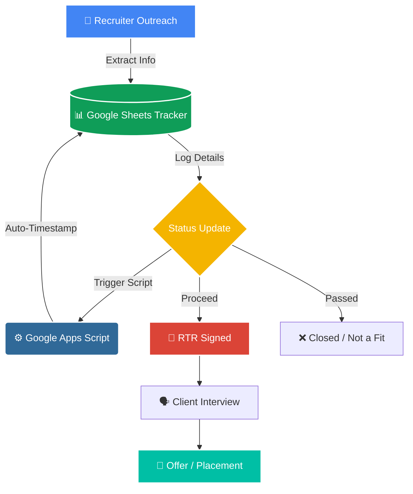

# 📊 Recruiter Tracking System (RTR)

A cloud-based tracking system designed to organize recruiter outreach, manage Right to Represent (RTR) submissions, and monitor staffing firm relationships during the job search process. 

## 🏗️ Workflow & Data Pipeline

## 🎯 Purpose
Managing high-volume recruiter communications requires structured data. This system transforms scattered messages and emails into a centralized pipeline, ensuring no opportunity is lost and follow-ups are timely.

## ✨ Key Features
* **Standardized Logging:** `RTR_Template.csv` structural framework for tracking firm details, direct contacts, and role specs.
* **Apps Script Automation:** `rtr_automation.js` listens for status changes (e.g., from "Initial Contact" to "RTR Signed") and automatically injects a "Last Updated" timestamp.
* **Pipeline Visibility:** Centralized view of all pending submissions, client interviews, and requested salary ranges.

## 👨‍💻 Author
**Himavanth Mallela**  
Data Engineer | Cloud & Big Data Specialist